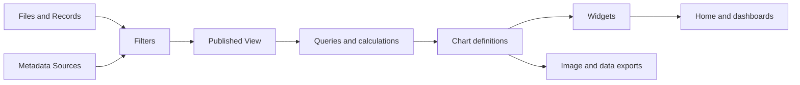

# Visualization system proposal

Status: design proposal for discussion. No application behavior changes are included.

## Recommendation

Build an editable chart system alongside Filters. Reference applications supply presets and acceptance examples.
Each reference chart should be expressible as a saved definition, with editable fields, calculations, and appearance.
The complete Last.fm Stats inventory is the baseline. LastWave is the next priority.

Keep the existing File, Record, Play, Source, Filter, and View vocabulary.
The following names are proposed additions, rather than previously agreed vocabulary:

| Term | Meaning |
|---|---|
| Query | Selects data and describes calculations producing a result. |
| Chart | Combines a query with instructions for drawing its result. Includes tables and single statistics. |
| Preset | An editable starting definition for a query, chart, or dashboard. |
| Widget | Places a chart or native component within a dashboard. References a definition rather than copying its logic. |
| Dashboard | Saves widget placement, sizes, and shared selections. Home is a designated dashboard. |

Queries can be embedded in charts initially. Named, shared queries can be introduced when reuse warrants them.
Definitions need stable identifiers and format versions. Reusing a chart shares edits across its placements.
Duplicating a chart creates an independent definition. A preset update should offer a diff rather than replace personal changes.

## Relationship to existing subsystems

Filters continue to determine listening identity, attribution, qualification, inference, naming, grouping, and inclusion.
Chart conditions select within the published View. They do not save changes to Filters.
Existing Presentation filters still control music names and grouping. Chart appearance controls govern graphical properties.

Reuse the existing typed field registry, expression editor, boolean operators, and validation where their semantics agree.
Keep separate targets and execution contexts. Chart expressions produce calculations and graphical values, not record changes.

### Existing primitives to reuse

The existing `internal/filters` package already supplies a substantial expression foundation.
Its package name should not imply that charts need a second expression language.

| Existing capability | Shared use |
|---|---|
| Typed values, including dates, durations, lists, missing values, and unresolved values | Field selection, calculations, validation, and consistent unknown-data behavior. |
| Comparisons, boolean logic, membership, and missing-value predicates | Filter conditions and chart selections. |
| Arithmetic, conversions, and text operations | Derived filter values and calculated chart fields. |
| WHERE, MAP, COUNT, SUM, MIN, and MAX on collections | Reusable collection expressions and aggregate semantics. |
| IF, ELSE IF, ELSE, and schema-controlled assignments | Conditional calculations and expressions, with consumer-specific writable outputs. |
| Schema labels, choices, bounds, validation, and execution budgets | Shared expression-editor controls and diagnostics. |

New analytical capabilities include grouped dataset execution, distinct aggregation, windows, ranking, segmentation, and statistical functions.
The current evaluator handles values and supplied collections. It is not yet a general database query planner.
Large queries should execute through backend plans while preserving shared operator semantics.
For example, a grouped SQL SUM and the expression evaluator's SUM should agree on types and missing values.
They need not share an implementation that loads every row into memory.

Graphical marks, axes, scales, layers, and dashboard placement are new visualization concerns.
Matching, attribution, inferred listening, and publication remain domain-specific Filter behavior.
A later neutral package boundary can expose the common expression core without changing saved Filter definitions.
This is a planned reuse/refactoring boundary, rather than a request to duplicate the existing engine.

Examples:

- Matching two track names affects every chart through the View.
- Selecting a date range affects the current chart or dashboard.
- Selecting only observed evidence narrows that query. A persistent Inclusion filter remains a separate choice.
- Calculating listening eras produces analytical intervals. It does not create inferred plays.
- A rolling average changes a plotted series. It does not change underlying play counts.
- Collection ownership and playlist membership can be explored as metadata. Converting them into listening remains an Inference decision.

The default query input is the View. Future explicit inputs may include Records, library metadata, collections, and playlists.
Each input must identify what one row represents. Counting Records and counting Plays answer different questions.
Current playback remains separate from completed listening. Home can retain native playback widgets alongside configurable charts.

## Atomic query operations

The query builder should expose composable operations rather than individual music-statistic switches:

| Operation | Examples |
|---|---|
| Select | Published listening, catalog entities, playlist membership, imported records. |
| Restrict | Typed comparisons, AND, OR, NOT, NOR, nested conditions, missing-value tests. |
| Derive | Arithmetic, IF/ELSE, text operations, date parts, duration conversion, numeric bins. |
| Group | Artist, shared track identity, album appearance, day, month, genre. |
| Aggregate | Count, distinct count, sum, mean, minimum, maximum, median, percentile. |
| Order and rank | Sort, top N, tied ranks, configurable treatment of remaining items. |
| Window | Running totals, moving averages, previous value, ranking changes, rolling comparisons. |
| Segment | Consecutive runs, gaps, listening sessions, threshold crossings, adjacent interval merging. |
| Normalize | Percent of total, concentration, distribution statistics, standardized deviation. |

Complex statistics still require implemented operators. Their compositions and parameters should remain editable.
An unlimited visual programming environment would make the initial project much larger.
The practical target is a finite, extensible vocabulary of typed operations covering all requested reference statistics.

Session boundaries, temporal ordering, ties, empty periods, and first-listen baselines need explicit definitions.
For example, a session gap should be configurable rather than permanently fixed at thirty minutes.
The Eddington-style statistic and an artist play-count index can share a ranked-threshold calculation.
Era detection can combine time buckets, relative shares, smoothing, thresholds, and interval merging.

## Atomic chart operations

A chart definition should describe:

- Marks: bars, lines, areas, points, rectangles, text, images, and rules.
- Encodings: horizontal position, vertical position, color, size, label, shape, opacity, and ordering.
- Scales: numerical, chronological, categorical, linear, logarithmic, and percentage.
- Composition: multiple series, layers, small multiples, stacking, and linked selections.
- Controls: parameters exposed to the viewer, with meaningful defaults and allowed values.
- Interaction: hover details, selection, zoom, drilldown, and navigation to existing music pages.
- Appearance: theme inheritance, legend placement, number formatting, labels, and export dimensions.

Familiar chart-type choices should configure these pieces as shortcuts. The resulting definition remains editable.
Clouds, collages, and posters also need reusable placement operations such as grids, packing, and tiers.
They should consume query results through the same contract as ordinary charts.

### One query, several charts

| Part | Example |
|---|---|
| Input | Dated plays from the published View. |
| Selection | A chosen period and artist selection. |
| Grouping | Calendar month and artist identity. |
| Measure | Number of distinct Plays. |
| Initial drawing | Stacked areas, month horizontally, play count vertically, artist as color. |
| Editable variants | Lines, grouped bars, percentage shares, or a centered streamgraph. |

Adding another grouping or changing the period should not require a new React chart component.
A heatmap similarly combines date buckets, rectangle marks, and color mapped to a measure.
A receipt combines ranked rows, text, separator rules, and an export layout.

## Builder and navigation

Statistics should open a library of personal charts and editable presets, with access to dashboards.
Creating a chart should provide Data, Calculations, Chart, and Appearance controls alongside a live preview.
These are editor sections, not additional sidebar destinations.
Fields should be searchable and grouped by meaning. The editor should explain incompatible field choices briefly.

Start from any preset, change either axis, change the aggregation, add conditions, and save an independent chart.
Computed fields should use the same familiar expression controls as Filters where appropriate.
Advanced configuration should remain available without requiring JSON editing for ordinary work.

Home is the designated dashboard, including the live listening feed and chosen charts.
Music pages reuse charts with the artist, album, or track selection already supplied.
Rewind should become a substantial editable recap preset, with Last.fm Stats as its baseline.
Offer both dashboard and story presentation over the same widgets and results.
Story presentation orders sections for reading or sharing. It does not introduce another statistics implementation.
Narrative text can bind templates to calculated values and conditional expressions.
Every numerical claim should link to its underlying calculation and listening.
Ongoing periods should compare against the same elapsed portion of the comparison period.

Recommended eventual sidebar: Home, Statistics, Search, and Settings.
Imports and Filters remain full pages accessible through Settings and existing contextual links.
Keeping Filters directly accessible during cleaning is reasonable. Optional pinned shortcuts can follow demonstrated need.
Navigation changes should follow a working prototype, rather than precede the chart design.

## Data fidelity and shared meanings

- Use the View's shared track identities and album grouping decisions throughout analyses.
- Multiple contributing Sources can support one Play. Selecting several Sources uses a union of distinct Plays.
- Source breakdowns need explicit overlap semantics. Independently counted source bars may overlap.
- Genre and tag relationships also need explicit weighting when one artist has several labels.
- Undated counts support all-time totals. Calendar calculations use dated listening.
- Estimated dates and attribution retain their evidence classifications.
- Actual played duration, recording duration, and estimated listening time are separate fields.
- Unknown duration remains unknown. Coverage should accompany listening-time totals.
- First recorded listening is distinct from first-ever discovery or an album's release date.
- Missing dates and incomplete source coverage affect gaps, streaks, and discovery claims.
- External popularity describes its acquisition period. It cannot establish historical popularity automatically.
- Drilldowns should reveal the Plays and supporting Records behind a result.

External enrichment belongs in Sources with acquisition dates and preserved responses.
Queries use stored metadata. Opening a chart should not fetch every artist's metadata from external services.

## Rendering recommendation

Evaluate Vega-Lite and Vega as the rendering foundation before extending the existing Recharts implementation.
Vega-Lite supplies declarative field mappings, transforms, stacking, and composed charts.
Vega includes additional placement transforms such as word clouds.

Keep our query semantics and saved chart contract independent of the renderer.
Compile large calculations on the backend and send compact results to the browser.
The chart library should not redefine what constitutes a Play or silently aggregate raw evidence.
Specialized rendering may still be necessary for LastWave's curved labels and designed image exports.
Such additions should be reusable renderers or placement operations, rather than hardcoded statistics.

Use Koito's theme variables, fonts, spacing, icons, menus, and tooltip conventions.
Maintain entity colors consistently across charts within a View. Include readable legends and accessible alternatives.
Export designs can have their own visual character while retaining the same editor controls.

## Performance contract

Caching alone cannot make a full View rebuild instantaneous. View publication and chart loading have separate performance budgets.

1. Store reusable summaries for common dates, entities, measures, and relationships.
2. Compile normalized query definitions into reusable backend calculations.
3. Persist calculation results across restarts, keyed by published View revision and calculation version.
4. Include selections, timezone, grouping, evidence treatment, and relevant metadata revisions in cache identity.
5. Exclude purely graphical changes from calculation keys when they leave the result unchanged.
6. Prepare Home and frequently used queries in the background.
7. Load visible charts first and deduplicate simultaneous requests for identical results.
8. Bound result sizes through suitable bucketing, pagination, and explicit top-N rules.
9. Recompute affected summaries after imports, matching changes, and exclusions. Historical periods can change in this fork.
10. Keep each displayed result tied to one published View. Avoid silently mixing revisions across a dashboard.

Distinct counts, medians, sessions, streaks, and eras need appropriate stored state or recomputation.
Summing daily distinct counts does not yield a correct monthly distinct count.
Summary selection should be automatic and preserve query meaning.
Avoid precomputing every possible combination of fields and conditions.

Proposed acceptance targets, not measurements: cached query responses under 200 ms and usable Home within one second locally.
Measure cold requests separately. Complex uncached analyses can run in the background with visible progress.
Benchmarks must use the actual listening corpus and document hardware and dataset size.

## Reference inventory and acceptance scope

Last.fm Stats was inspected at revision `4abc206934a7a6342db3de0942a6ff613bdf8d04`.
Every row below represents editable presets over the shared system, rather than a dedicated feature implementation.

| Last.fm Stats family | Preset coverage | Reusable requirements |
|---|---|---|
| Listening and library growth | Listening volume and entity growth over time. | Date grouping, cumulative counts, multiple series. |
| Artist breadth | Track diversity within each artist, with trend fitting. | Distinct identities, aggregation, regression. |
| Monthly leaders | Leading artists, albums, or tracks by month. | Grouped ranking, entity-type parameter. |
| Exceptional months | Unusually strong monthly listening relative to an item's baseline. | Mean, standard deviation, minimum evidence, z-score. |
| Accumulating favorites | Cumulative listening for selected entities. | Running totals, series selection. |
| Diversity | Leading-five concentration and effective diversity over time. | Shares, entropy, expression composition. |
| Discovery cohorts | Listening grouped by first recorded discovery year. | First occurrence, cohort grouping, stacking. |
| Name analysis | Weighted words and initial-letter distributions. | Text extraction, exclusions, grouping, cloud placement. |
| Calendar patterns | Punchcards and individual-play scatter displays. | Date parts, bins, point sizing, time-of-day axes. |
| Daily listening | Daily volume and its distribution. | Day grouping, frequencies, ranked thresholds. |
| Animated rankings | Cumulative and rolling rankings for music entities. | Windowing, ranking, stable colors, playback controls. |
| Recurring periods | Hour, weekday, and month distributions, including averages. | Calendar grouping and explicit denominators. |
| Listening time | Duration-based summaries where evidence supports them. | Duration measures and coverage. |
| Artist lists | Historical/current gaps, active weeks, breadth, discovery bursts, concentration, returns, rank movements, repeated runs. | Sequence operations, distinct counts, first/mean dates, windows. |
| Album and track lists | Gaps, active weeks, rank changes, repeated runs, discovery summaries, album-credit and missing-album details. | The same operators with another entity selection. |
| Listening lists | Active/inactive runs, busiest periods, concentrated artist days, and long sessions. | Calendar runs, ranking, session segmentation. |
| General statistics | Coverage, first/latest listening, counts, ratios, ranked thresholds, recurring yearly favorites, and anniversaries. | Scalar results, date arithmetic, grouped comparisons. |
| Dataset details | Searchable item tables, history, rankings, and item drilldowns. | Existing native search links, paginated results, reusable detail queries. |
| Metadata exploration | Artist geography and genre distributions. | Stored enrichment, geography, explicit tag weighting. |
| Recaps and outputs | Full recap sections, chart expansion, image download, and dataset export. | Dashboard/story presets, result-bound text, and shared exporters. |

Source definitions, adjustable thresholds, toggles, and drilldowns must be captured when implementing each preset.
The inventory is the acceptance scope, not a claim that every mathematical definition is settled.

The list presets also explicitly include the following variants:

- Artist activity across weeks, unique track breadth, monthly first discoveries, and monthly distinct artists.
- The strongest newly discovered artist within a month and artists represented by only one track.
- Average listening per artist and per track, with configurable minimum evidence.
- Earliest/latest mean listening dates, mean intervals, and latest first-recorded artists.
- Historical and ongoing gaps, active weeks, monthly rank changes, and consecutive runs across all supported music types.
- Track discovery and distinct-track counts within individual months.
- Album credit breadth and listening without supplied album metadata.

Mean listening dates describe when music was played. They do not describe release age.

### Rewind baseline

The reviewed recap includes the following sections. Each belongs in the preset coverage checklist:

- Period introduction and selection, including an unfinished current year.
- Listening totals, active days, cumulative listening, and comparison with the previous period.
- Favorite artists, albums, and tracks, with linked rankings and supporting graphics.
- Rising and falling artists compared with the previous year.
- New artists, their discovery trends, and leading discoveries.
- Calendar activity, busy months, daily records, listening streaks, and longest breaks.
- Hourly patterns and the dominant listening hour.
- Listening sessions, their distribution, leading sessions, and repeated artist, album, and track runs.
- Words associated with the period's listening.
- Shareable recap output.

Our system should also allow album/track discovery variants, alternate periods, comparisons, section ordering, and personal additions.
These are editable parameters and composition, rather than a second hardcoded recap application.

| Additional reference | Proposed role |
|---|---|
| LastWave | Priority after baseline query/chart primitives. Reusable streamgraph, music grouping, labels, SVG/PNG outputs. |
| Eras | Editable composition of smoothing, share thresholds, and interval segmentation. |
| Album Explorer | Album exploration by year, decade, or selected range. Its embedded interactive content needs a further functional pass. |
| Rainbow Collage | Artwork grid with color-based ordering and configurable dimensions. |
| Tag Cloud | Metadata terms with configurable contribution weights. |
| Receiptify | Ranked-table export with receipt styling. |
| Iceberg | Tiered artist export. Personal frequency and external popularity are distinct possible measures. |
| Instafest | Ranked artists arranged as a festival poster. |

Album Explorer's outer page loaded in Chromium. Its embedded frame remained blank during review.
Its exact interactive options are therefore unverified, and should not be invented.

## Development sequence

1. Agree on vocabulary, query inputs, chart composition, Home's role, and the persistent-Filter boundary.
2. Specify typed fields, row identities, relationships, units, missing values, and calculation ordering.
3. Prototype three editable definitions: a time-series chart, a heatmap, and a streamgraph.
4. Prove axis changes, aggregation changes, conditions, computed fields, grouping, and table conversion within that prototype.
5. Benchmark rendering and shared cached results using actual listening. Select the rendering foundation from evidence.
6. Implement saved definitions, duplication, parameters, schema validation, theme bindings, and basic exports.
7. Implement remaining analytical operators and express the entire Last.fm Stats inventory, including its full recap, as editable presets.
8. Add dashboard placement and replace overlapping Home, Rewind, and entity-page implementations incrementally.
9. Add LastWave refinements, eras, enriched metadata graphics, and designed exports through the same contracts.
10. Validate source overlaps, matching changes, estimated/undated evidence, query correctness, cache invalidation, and accessibility.

Each milestone needs real-data examples and correctness checks. Presets should have expected outputs independent of renderer screenshots.
Passing the first three chart examples does not establish full reference-feature coverage.
Preserve the existing personal Filters until their previously agreed final redesign before deployment.
This feature work precedes the existing Phase 9 migration and deployment plan. Numbering can be reconciled after agreement.

## Scope boundaries and decisions for discussion

Feasible foundation: typed queries, composable drawing definitions, editable presets, reusable calculations, dashboards, and caching.
Larger follow-on work: arbitrary relationship joins, unrestricted nested pipelines, complex animations, poster composition, and specialized label placement.
Reusable operators can be implemented in stages while preserving the complete requested preset scope.

The main decisions are:

1. Does Query → Chart → Widget → Dashboard describe the intended separation clearly?
2. Should Home be a designated editable dashboard, retaining native playback widgets?
3. Is a visual builder with advanced expressions the preferred editing experience?
4. Should chart edits be shared by reference until explicitly duplicated?
5. Should Imports and Filters eventually move under Settings, with contextual links retained?

## Sources

- [Last.fm Stats source at the reviewed revision](https://github.com/felhag/lastfm-stats-web/tree/4abc206934a7a6342db3de0942a6ff613bdf8d04/projects/shared/src/lib)
- [Reviewed recap sections](https://github.com/felhag/lastfm-stats-web/blob/4abc206934a7a6342db3de0942a6ff613bdf8d04/projects/shared/src/lib/recap/recap.component.html)
- [LastWave](https://github.com/taurheim/LastWave)
- [Eras product definition](https://github.com/MatRanc/eras/blob/main/PRODUCT.md)
- [Album Explorer](https://sortedsongs.com/tools/album-explorer/)
- [Rainbow Collage](https://www.chartmymusic.com/lastfm/rainbowcollage/)
- [Tag Cloud and its weighting explanation](https://github.com/TheTeaCat/lastfm-tag-cloud)
- [Receiptify](https://github.com/michellexliu/receiptify)
- [Iceberg](https://github.com/explodingcamera/lastfm-iceberg)
- [Instafest](https://www.instafest.app/)
- [Vega-Lite encodings](https://vega.github.io/vega-lite/docs/encoding.html), [transforms](https://vega.github.io/vega-lite/docs/transform.html), [composition](https://vega.github.io/vega-lite/docs/composition.html), and [stacking](https://vega.github.io/vega-lite/docs/stack.html)
- [Vega word-cloud placement](https://vega.github.io/vega/docs/transforms/wordcloud/)
